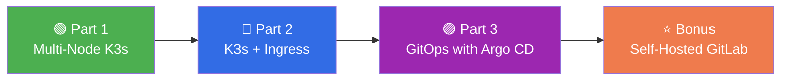
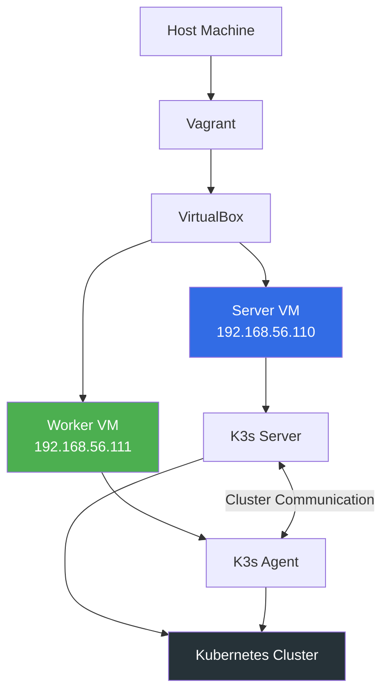
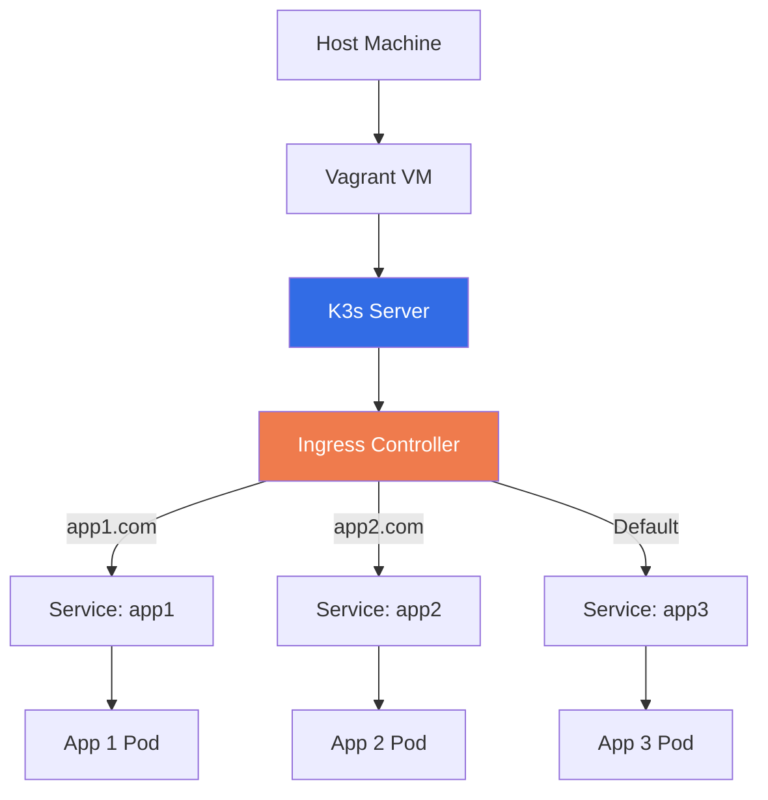
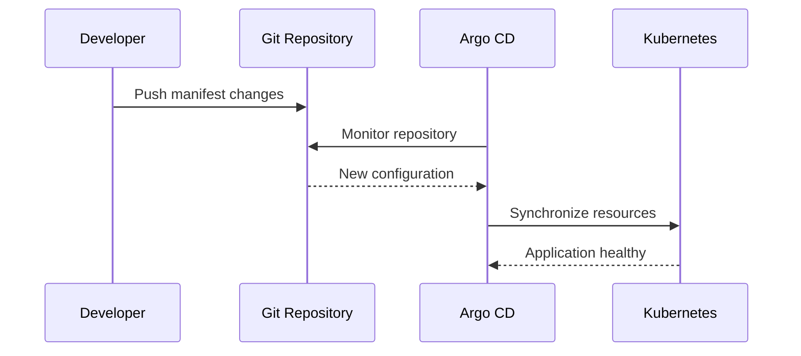
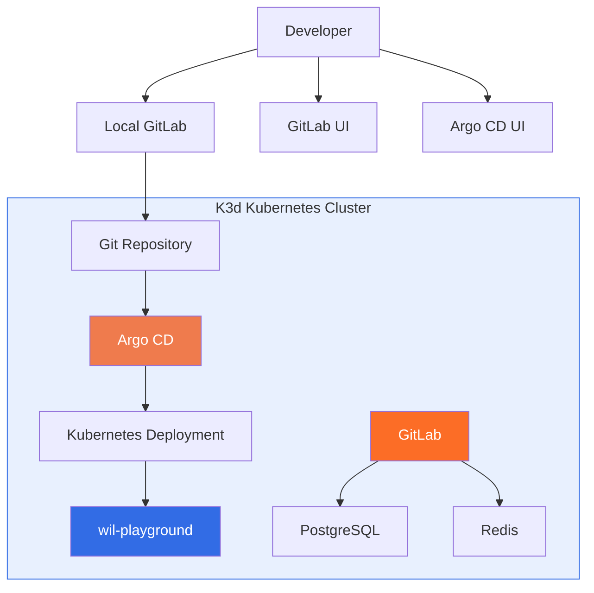
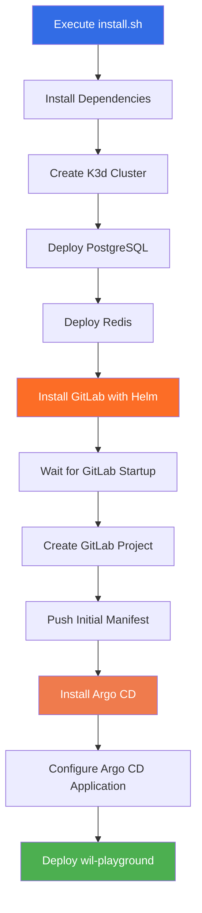
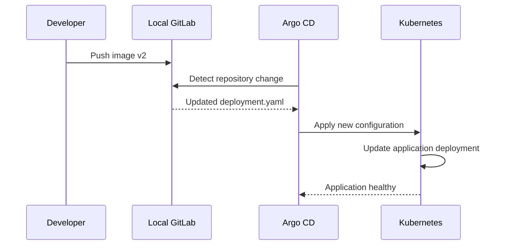

# 🚀 Inception of Things

<p align="center">
  <strong>42 School Project</strong><br>
  A progressive journey from virtual machines to Kubernetes and GitOps.
</p>

<p align="center">
  
  
  
  
</p>

---

## 📖 About the Project

**Inception of Things (IoT)** is a 42 School project that introduces the fundamentals of **container orchestration**, **infrastructure automation**, and **GitOps**.

The project is structured as a progressive journey — each part builds on the previous one, gradually introducing new technologies and concepts until you reach a fully self-hosted GitOps pipeline.

### What You Will Learn

- 🖥️ **Virtualization** — Provisioning VMs with Vagrant
- ☸️ **Kubernetes** — Deploying and managing containerized workloads with K3s
- 🌐 **Networking** — Private networks, services, and ingress routing
- 🐳 **Containerization** — Running Kubernetes inside Docker with K3d
- 🔄 **GitOps** — Automating deployments with Argo CD
- 🦊 **Self-Hosting** — Running GitLab, PostgreSQL, and Redis inside a cluster

---

## 🗺️ Project Roadmap



| Part | Infrastructure | Objective |
|:----:|:---------------|:----------|
| **1** | Vagrant + K3s | Multi-node Kubernetes cluster |
| **2** | Vagrant + K3s | Multiple applications with ingress routing |
| **3** | Docker + K3d + Argo CD | Local GitOps workflow |
| **Bonus** | K3d + GitLab + Argo CD | Complete self-hosted GitOps ecosystem |

---

## 🛠️ Technologies

| Category | Technologies |
|:---------|:-------------|
| **Virtualization** | Vagrant, VirtualBox |
| **Orchestration** | Kubernetes, K3s, K3d |
| **Containers** | Docker |
| **CLI & Packaging** | kubectl, Helm |
| **GitOps** | Argo CD |
| **Self-Hosting** | GitLab, PostgreSQL, Redis |
| **Web** | Nginx |

---

## 🟢 Part 1 — Multi-Node K3s Cluster

### Overview

The first part introduces Kubernetes through a lightweight **K3s cluster** running on virtual machines provisioned with **Vagrant**. Two VMs communicate over a private network: one acts as the **server** (control plane) and the other as an **agent** (worker node).

### Architecture



### Nodes

| Node | Hostname | IP Address | Role |
|:-----|:---------|:-----------|:-----|
| Server | `obelhamiS` | `192.168.56.110` | K3s Server |
| Worker | `obelhamiSW` | `192.168.56.111` | K3s Agent |

### How to Run

```bash
# 1. Navigate to Part 1
cd p1

# 2. Provision the virtual machines
vagrant up

# 3. Connect to the server node
vagrant ssh obelhamiS

# 4. Verify the cluster
sudo kubectl get nodes -o wide
sudo kubectl get pods -A
```

**Expected result:** A functional two-node Kubernetes cluster with one server and one worker.

---

## 🔵 Part 2 — K3s with Ingress

### Overview

Part 2 focuses on deploying **multiple web applications** on a single-node K3s cluster. Three Nginx-based applications are exposed through **Kubernetes Services**, and an **Ingress resource** routes incoming HTTP requests to the correct application based on the request hostname.

### Architecture



### Routing Rules

| Application | Hostname | Destination |
|:------------|:---------|:------------|
| App 1 | `app1.com` | `app1` Service |
| App 2 | `app2.com` | `app2` Service |
| App 3 | Default route | `app3` Service |

### How to Run

```bash
# 1. Start the virtual machine
cd p2
vagrant up
```

Then add the following entries to your **host machine's** `/etc/hosts`:

```text
192.168.56.110  app1.com
192.168.56.110  app2.com
```

Test the applications:

```bash
curl http://app1.com        # <h1>Welcome to app1</h1>
curl http://app2.com        # <h1>Welcome to app2</h1>
curl http://192.168.56.110  # <h1>Welcome to app3</h1>
```

**Expected result:** Three independently deployed applications accessible through a single IP via host-based HTTP routing.

---

## 🟣 Part 3 — GitOps with K3d and Argo CD

### Overview

Part 3 introduces **GitOps** and automated application deployment. Rather than applying manifests manually, **Argo CD** continuously monitors a Git repository and synchronizes the cluster with the desired state declared in Git.

A **K3d cluster** (K3s running inside Docker) provides a lightweight local Kubernetes environment.

### GitOps Workflow



### Prerequisites

- Linux environment (tested on Ubuntu)
- Internet connection
- Docker-compatible environment
- Permission to install system dependencies

### How to Run

```bash
# 1. Install dependencies (Docker, K3d, kubectl, Argo CD CLI)
cd p3/scripts
./install.sh
```

> ⚠️ **Important:** If the script adds your user to the `docker` group, **log out and log back in** before continuing. Verify with `docker ps`.

```bash
# 2. Create the cluster and configure Argo CD
./setup.sh
```

The setup script automatically:

- Creates a K3d cluster
- Installs Argo CD
- Connects Argo CD to the Git repository (`lassachraf/iot-alassiqu`)
- Configures the GitOps application and synchronization

### Accessing the Application

```
http://localhost:8888
```

### Accessing Argo CD

```bash
# Enable port forwarding
kubectl -n argocd port-forward svc/argocd-server 8080:443
```

Open **http://localhost:8080** and log in:

| Field | Value |
|:------|:------|
| Username | `admin` |
| Password | Printed by `setup.sh` |

**Expected result:** A working GitOps environment where Argo CD automatically deploys the application from a remote Git repository.

---

## ⭐ Bonus — Self-Hosted GitLab and Argo CD Pipeline

### Overview

The bonus takes GitOps to its logical conclusion: a **fully self-hosted** GitOps ecosystem. Instead of relying on an external Git host, a private **GitLab** instance runs inside the K3d cluster, backed by **PostgreSQL** and **Redis**. Argo CD monitors this internal GitLab repository and deploys the **wil-playground** application — all without touching an external service.

### Architecture



### Components

| Component | Role |
|:----------|:-----|
| K3d | Local Kubernetes cluster |
| Docker | Container runtime |
| Helm | Package manager for GitLab |
| GitLab | Self-hosted Git repository & DevOps platform |
| PostgreSQL | GitLab database dependency |
| Redis | GitLab cache & background jobs |
| Argo CD | GitOps continuous delivery |
| wil-playground | Application deployed through GitOps |

### How to Run

> ⚠️ **Warning:** This setup is **resource-intensive**. GitLab startup can take **15–25 minutes** depending on your machine.

```bash
cd Bonus/scripts
sudo ./install.sh
```

### Installation Workflow



### GitOps in Action — Updating the Application

One of the most interesting aspects of this bonus: application updates happen **entirely through Git**.

```bash
# 1. The script keeps a local copy of the repo at /tmp/iot-repo
cd /tmp/iot-repo

# 2. Edit confs/deployment.yaml and change the image tag
#    from: image: wil42/playground:v1
#    to:   image: wil42/playground:v2

# 3. Commit and push
git add .
git commit -m "Update application to v2"
git push
```

**Argo CD detects the change and automatically synchronizes the cluster.** No manual `kubectl apply` required.



**Expected result:** A complete local GitOps pipeline — GitLab for source control, Argo CD for deployment — with no external dependencies.

---

## 📁 Project Structure

```text
Inception-of-Things/
│
├── p1/
│   ├── Vagrantfile
│   └── ...
│
├── p2/
│   ├── Vagrantfile
│   └── ...
│
├── p3/
│   ├── scripts/
│   │   ├── install.sh
│   │   └── setup.sh
│   └── ...
│
├── Bonus/
│   ├── scripts/
│   │   └── install.sh
│   └── ...
│
└── README.md
```

---

## 🧠 Learning Outcomes

| Concept | What We Learned |
|:--------|:----------------|
| Virtualization | Provisioning VMs with Vagrant |
| Kubernetes | Deploying and managing containerized workloads |
| K3s | Building lightweight Kubernetes clusters |
| K3d | Running Kubernetes clusters inside Docker |
| Networking | Private networks, services, ingress routing |
| Containerization | Running and managing containers |
| Helm | Installing and managing Kubernetes applications |
| GitOps | Managing infrastructure through Git |
| Argo CD | Automating Kubernetes deployments |
| GitLab | Self-hosting a private Git platform |

---

## 🧰 Useful Commands

<details>
<summary><b>Vagrant</b></summary>

```bash
vagrant up
vagrant halt
vagrant destroy
vagrant ssh
vagrant status
vagrant reload
```
</details>

<details>
<summary><b>Docker</b></summary>

```bash
docker ps
docker images
docker logs <container>
docker exec -it <container> sh
```
</details>

<details>
<summary><b>K3d</b></summary>

```bash
k3d cluster list
k3d cluster create <cluster-name>
k3d cluster delete <cluster-name>
```
</details>

<details>
<summary><b>Kubernetes</b></summary>

```bash
kubectl get nodes -o wide
kubectl get pods -A
kubectl get services -A
kubectl get deployments -A
kubectl get namespaces
kubectl get ingress -A
kubectl describe pod <pod-name>
kubectl logs <pod-name>
kubectl apply -f <manifest.yaml>
kubectl delete -f <manifest.yaml>
```
</details>

<details>
<summary><b>Argo CD</b></summary>

```bash
kubectl get pods -n argocd
kubectl get applications -n argocd
kubectl get services -n argocd
```
</details>

---

## 📚 Resources

| Technology | Documentation |
|:-----------|:--------------|
| Kubernetes | https://kubernetes.io/docs/ |
| K3s | https://docs.k3s.io/ |
| K3d | https://k3d.io/ |
| Vagrant | https://developer.hashicorp.com/vagrant/docs |
| Docker | https://docs.docker.com/ |
| Helm | https://helm.sh/docs/ |
| Argo CD | https://argo-cd.readthedocs.io/ |
| GitLab | https://docs.gitlab.com/ |
| PostgreSQL | https://www.postgresql.org/docs/ |
| Redis | https://redis.io/docs/ |

---

## 👥 Authors

| Member | GitHub |
|:-------|:-------|
| Member 1 | [@AchrafLassiqui](https://github.com/lassachraf) |
| Member 2 | [@AmineKaddouri](https://github.com/aminekaddouri) |
| Member 3 | [@OmarBelhamid](https://github.com/obelhami) |

---

<p align="center">
  <strong>42 School — Inception of Things</strong><br/>
  From Virtual Machines to Kubernetes and GitOps 🚀
</p>

<p align="center">
  Made with ❤️, teamwork, and a lot of debugging.
</p>
